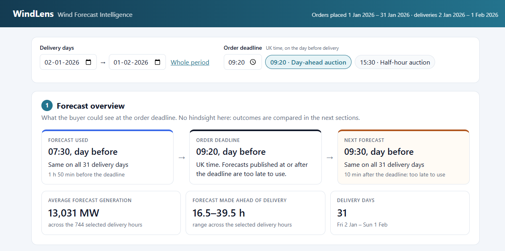
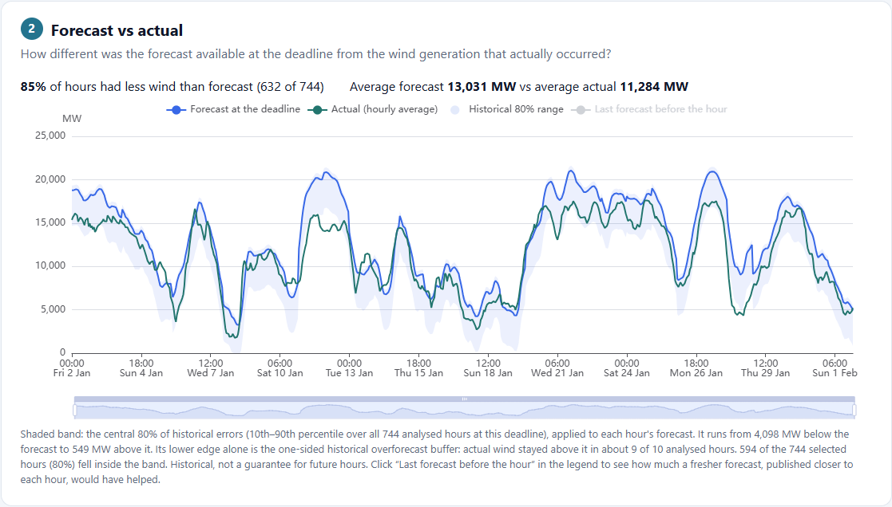
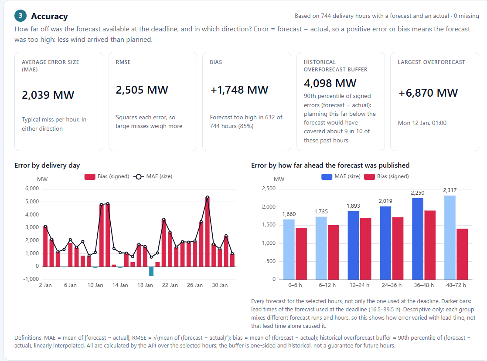
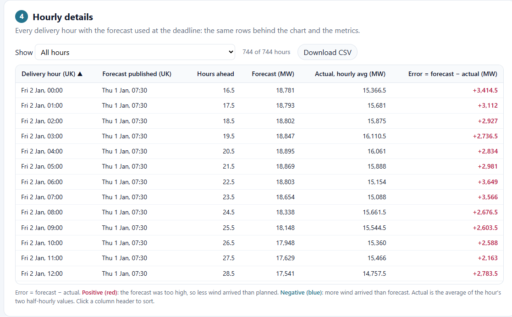

# WindLens · Wind Forecast Intelligence

WindLens shows a UK electricity buyer **which wind forecast they actually had when they placed their day-ahead
order**, and **how wrong that forecast turned out to be**, so they can decide how much extra power to buy.

**Live app:** https://tq8wzr.vercel.app (no login needed; see [Deployment](#5-deployment-vercel))

---

## 1. Project overview

A UK energy utility buys electricity in the day-ahead market on the day before delivery. Wind covers part of
its customers' demand, so the team needs a reliable view of tomorrow's wind generation before the auction closes.
Wind is forecast many times a day, and a forecast that arrives after the deadline is no use to the buyer.

WindLens answers two questions for **orders placed in January 2026**:

1. **What did the forecast say at the decision deadline?** For each delivery day it picks the newest forecast
   published before the deadline, never a later one.
2. **How accurate was it?** It compares that forecast with actual wind generation and quantifies the error:
   its typical size, its direction and a historical buffer for planning.

The dashboard has four sections:

| Section | Question it answers |
|---|---|
| 1 · Forecast overview | Which forecast was available at the deadline, and which one arrived too late? |
| 2 · Forecast vs actual | How different was that forecast from the wind that actually came? |
| 3 · Accuracy | How large and in which direction were the errors, and how do they vary by day and lead time? |
| 4 · Hourly details | Which individual hours went wrong? (sortable, filterable, CSV export) |

Controls let the user pick any range of delivery days and any order deadline (UK time, on the day before
delivery). Every figure on the page comes from the API; nothing is hard-coded in the frontend.

## 2. Key findings (January 2026, historical)

Scope: orders placed 1–31 Jan 2026, i.e. **deliveries 2 Jan – 1 Feb 2026** (31 days, 744 hours), with the
default **09:20** deadline (UK time, day before delivery). These figures describe this period only. They are
**not a guarantee** of future accuracy.

| Finding | Result |
|---|---|
| Forecast available at the deadline | The **07:30** forecast, on all 31 days. The 09:30 forecast arrived **10 minutes after** the deadline. |
| Direction | Forecast **too high in 632 of 744 hours (85%)**. Bias **+1,748 MW** (average forecast 13,031 MW vs actual 11,284 MW). |
| Size | MAE **2,039 MW**, RMSE **2,505 MW**. Largest overforecast **+6,870 MW** (Mon 12 Jan, 01:00). |
| Historical overforecast buffer | **4,098 MW** (90th percentile of signed errors). Actual wind fell further below the forecast than this in 75 of 744 hours (10.1%). |
| Exceptional day | **28 Jan**: average error 5,375 MW. Actual wind was below the historical band in all 24 hours. |
| Lead time (descriptive) | MAE rises from 1,660 MW (forecasts made 0–6 h ahead) to 2,317 MW (48–72 h ahead). Bias is positive at every lead time. |
| Later deadline | Deciding at the **15:30** half-hour auction (11:30 forecast) gives a buffer of **3,847 MW**, 251 MW (about 6%) lower. This is lower historical uncertainty, not proof of better trading results. |
| Data quality | One off-schedule forecast (12:25 on 15 Jan, replacing the missing 11:30 run). Deadlines at or before 02:30 leave 22:00–23:00 without any forecast; those hours are reported as missing. |

**Worked example (hand-checked and covered by a test):** for 15 Jan 12:00, the forecast available at the
deadline was **11,049 MW** (published 14 Jan 07:30, 28.5 h ahead). Actual wind averaged **9,790.5 MW**
(9,742 MW and 9,839 MW in the two half-hours). Error = 11,049 − 9,790.5 = **+1,258.5 MW**.

## 3. Screenshots

**Section 1: the forecast available at the deadline, and the one that arrived too late**


**Section 2: forecast at the deadline vs actual wind, with the historical 80% band**


**Section 3: accuracy metrics, error by delivery day and by lead time**


**Section 4: every delivery hour, with filters, sorting and CSV export**


## 4. Quick start with Docker

Prerequisite: Docker Desktop (tested with 4.97) or Docker Engine with Compose v2.

```powershell
docker compose up --build
```

Then open **http://localhost:8000**. Interactive API documentation is at http://localhost:8000/docs.
Stop with `docker compose down`.

- **One image:** a two-stage [Dockerfile](Dockerfile). Node 22 builds the dashboard, then Python 3.14 runs FastAPI,
  which serves both the API and the dashboard from the same address.
- **No internet needed at runtime:** the January data is part of the repository and copied into the image.
- **Container behaviour:** runs as a non-root user, has a health check on `/api/health`, and listens on `$PORT`
  (default 8000). This was checked by running the image with `PORT=5000`.
- **Local only:** [compose.yaml](compose.yaml) publishes the port on `127.0.0.1`, so the app is not exposed to your
  network.

## 5. Deployment (Vercel)

The live app at **https://tq8wzr.vercel.app** runs on Vercel's free Hobby plan. Heroku, the other option in the
brief, needs a paid plan, so it was not used. Docker (section 4) is still the one-command way to run the app locally.

Vercel does not run Docker images, so it deploys the same code another way, with no code changes:

- It builds the dashboard (`npm ci && npm run build`) and runs the FastAPI app as a Python function.
- At build time it finds the dashboard's static-file mount in [main.py](backend/app/main.py) and serves those files
  from its CDN. Requests to `/api/...` still reach FastAPI, because the API routes are declared before that mount.
- The data snapshot is deployed with the code, so the live app makes no calls to Elexon.

| File | Role |
|---|---|
| [pyproject.toml](pyproject.toml) | Python version (3.14), FastAPI and tzdata pinned to the same versions as `backend/requirements.txt`, and where the app is (`backend.app.main:app`) |
| [vercel.json](vercel.json) | The dashboard build command, and the files kept out of the Python function (tests, scripts, docs, frontend source and `node_modules`) |
| [.vercelignore](.vercelignore) | Keeps local-only folders (`node_modules`, `.venv`, caches, the local dashboard build) and `docs` out of the upload |

To deploy your own copy (needs a free Vercel account and Node.js), run from the repository root:

```powershell
npm install -g vercel
vercel login
vercel deploy --prod
```

The first deploy asks you to create or link a Vercel project. The live app was checked without logging in: the page
and its assets load, the API returns the same figures as the local and Docker runs, invalid dates get the same clear
errors, and only the dashboard and the API can be reached (source and data files cannot).

## 6. Local development

Prerequisites: Python 3.14 and Node.js 22 (the versions tested). The commands below are for Windows PowerShell;
on macOS or Linux use `.venv/bin/python` instead of `.venv\Scripts\python`.

**Backend** (API on http://localhost:8000):

```powershell
cd backend
python -m venv .venv
.venv\Scripts\python -m pip install -r requirements-dev.txt
.venv\Scripts\python -m uvicorn app.main:app --reload --reload-dir app
```

**Frontend** (second terminal; dashboard on http://localhost:5173, which forwards `/api` to the backend):

```powershell
cd frontend
npm ci
npm run dev
```

The Docker container and the local backend both use port 8000, so stop one before starting the other.

**Refreshing the data** (optional, needs internet, standard library only). Run from the repository root:

```powershell
python backend/scripts/fetch_data.py
```

It downloads the forecasts and actuals again, saves them to `backend/data/` with their source URL and download
time, and prints a short data-quality report (runs per time of day, gaps, duplicates).

## 7. Tests

**Backend (31 tests):**

```powershell
cd backend
.venv\Scripts\python -m pytest
```

| File | What it proves |
|---|---|
| `test_analysis.py` | Each rule on small hand-made data: the deadline is UK time on the day before (including summer time), the newest forecast before the deadline is used, a forecast published exactly at the deadline is too late, actuals are averaged rather than summed, missing values are counted rather than treated as zero, and the metric definitions. |
| `test_january_data.py` | The real January results: 744 hours with nothing missing, the 07:30/09:30 timing, the worked example above, the missing 11:30 run, the headline figures, and that the buffer was exceeded in about 10% of hours. |
| `test_api.py` | API defaults, a later deadline picking a fresher forecast, and clear errors for invalid dates. |
| `test_frontend.py` | The built dashboard and its assets are served with the right content types, and API routes take precedence. |

**Frontend (7 tests)** for the hourly table's filtering, sorting and CSV export:

```powershell
cd frontend
npm test
```

`npm run build` also type-checks the whole frontend (TypeScript strict mode). All of these commands were verified on
a fresh clone of the repository.

## 8. Data and methodology

### Data: Elexon BMRS only

| Dataset | Endpoint | Use |
|---|---|---|
| Wind forecasts (WINDFOR) | `https://data.elexon.co.uk/bmrs/api/v1/datasets/WINDFOR/stream` | Hourly forecasts, published 8 times a day (02:30, 04:30, 07:30, 09:30, 11:30, 15:30, 18:30, 22:30 UTC). Each run covers 21:00 the day before publication to 21:00 two days after. |
| Actual generation (FUELHH, `fuelType=WIND`) | `https://data.elexon.co.uk/bmrs/api/v1/datasets/FUELHH/stream` | Half-hourly actual wind generation |

The snapshot holds every forecast published 31 Dec 2025 – 1 Feb 2026 (264 runs, 19,272 hourly values) and the actuals
for 2 Jan – 1 Feb 2026 (1,488 half-hours, no gaps or duplicates). It was downloaded on 27 Oct 2026 by
[backend/scripts/fetch_data.py](backend/scripts/fetch_data.py).

### Method

All rules are in [backend/app/analysis.py](backend/app/analysis.py).

1. **Deadline.** Orders for delivery day D close at the chosen time (UK time) on day D−1. The default, 09:20, is
   when EPEX SPOT's GB day-ahead auction closes. The 15:30 preset is its GB half-hour auction.
2. **Forecast used.** The newest forecast published **strictly before** the deadline. One published exactly at
   the deadline counts as too late. Real publish times are used, so off-schedule or missing runs are handled.
3. **Hourly actual.** Forecasts are hourly and actuals are half-hourly. The hourly actual is the **average** of the
   hour's two half-hours: MW is a rate, so averaging gives the hour's mean output. If either half-hour is missing,
   the hour is reported as missing.
4. **Error = forecast − actual.** A positive error means the forecast was too high, so less wind arrived than planned.
5. **Metrics** (over hours that have both values; missing hours are counted, never treated as zero):

   | Metric | Definition |
   |---|---|
   | MAE | mean of \|forecast − actual\| |
   | RMSE | √(mean of (forecast − actual)²) |
   | Bias | mean of (forecast − actual) |
   | Historical overforecast buffer | 90th percentile of (forecast − actual), linearly interpolated. Planning this far below the forecast would have covered about 9 in 10 of the analysed hours. |

6. **Historical band (Section 2).** Each hour's forecast minus the 10th–90th percentile of signed errors, taken over
   **all analysed hours at the selected deadline**. It is a two-sided central 80% range; only its lower edge is the
   one-sided buffer. Because it uses the whole period, a single selected day is judged against history, not
   against its own errors.
7. **Lead-time analysis (Section 3).** Every forecast published before each delivery hour, grouped by how many
   hours ahead it was made. This is descriptive only.

Times are stored in UTC and displayed in UK time (Europe/London). In January the two are the same.

**API:** `GET /api/dashboard?start=YYYY-MM-DD&end=YYYY-MM-DD&deadline=HH:MM` (all optional; defaults are the whole
period and 09:20) and `GET /api/health`.

## 9. Project structure

```text
.
├── Dockerfile                  Two-stage image: builds the dashboard, then runs FastAPI
├── compose.yaml                One-command local run (docker compose up --build)
├── .dockerignore               Keeps node_modules, .venv and .git out of the image
├── pyproject.toml              Vercel: Python version, dependencies and the app's entry point
├── vercel.json                 Vercel: dashboard build command and what stays out of the function
├── .vercelignore               Vercel: keeps local folders out of the upload
├── backend/
│   ├── app/
│   │   ├── analysis.py         Core rules: forecast at the deadline, hourly actuals, errors, metrics
│   │   ├── data_store.py       Loads the saved data
│   │   └── main.py             API (/api/dashboard, /api/health); serves the built dashboard
│   ├── data/
│   │   ├── forecasts.json      WINDFOR snapshot (with source URL and download time)
│   │   └── actuals.json        FUELHH wind snapshot (with source URL and download time)
│   ├── scripts/fetch_data.py   Downloads or refreshes the snapshot from Elexon
│   ├── tests/                  pytest suites (see Tests)
│   ├── requirements.txt        Runtime dependencies, pinned
│   ├── requirements-dev.txt    Adds the test dependencies
│   └── pyproject.toml          pytest settings
├── frontend/
│   ├── src/
│   │   ├── App.tsx             Loads data from the API and holds the selected dates and deadline
│   │   ├── api.ts              Response types (mirroring the Python dataclasses) and the fetch call
│   │   ├── format.ts           UK-time and MW formatting
│   │   ├── hourlyTable.ts      Table filtering, sorting and CSV export (tested in hourlyTable.test.ts)
│   │   ├── styles.css          Dashboard styles
│   │   └── components/         Controls, ForecastOverview (1), ForecastVsActual (2), Accuracy (3),
│   │                           HourlyDetails (4) and EChart (chart wrapper)
│   ├── package.json            Scripts and dependencies (exact versions in package-lock.json)
│   └── vite.config.ts          Development server; forwards /api to port 8000
└── docs/screenshots/           Images used in this README
```

## 10. Limitations and assumptions

- **One historical month.** All results describe 744 hours in January 2026 and are calculated over that same data.
  They are not forecasts of future accuracy and give no guarantee for future hours.
- **Decision deadline.** The 09:20 default follows the EPEX GB day-ahead auction. The team's real cut-off may be
  earlier, for example to prepare bids. A forecast is treated as usable from its publish time with no
  publication delay; an earlier deadline can model preparation time.
- **Hourly comparison.** Forecasts are hourly, so the half-hourly actuals are averaged to hourly values.
- **Possible definitional gap.** Both datasets describe national wind generation from Elexon, but they may not cover
  exactly the same wind farms, and actual output can be reduced on instruction from the grid operator. Part of the
  consistent positive bias may come from such differences rather than from weather forecasting. This was not
  investigated, because the brief limits the analysis to these two datasets.
- **Missing forecasts.** With deadlines at or before 02:30, the newest forecast does not cover 22:00–23:00 of the
  delivery day. Those hours are shown as missing and excluded from the metrics, never treated as zero.
- **Data snapshot.** The data was downloaded once. Elexon may revise published data; re-run the fetch script to
  refresh it.
- **Comparisons are descriptive.** The lead-time chart and the 15:30 comparison show associations, not causes, and
  without price data they say nothing about trading costs.
- **Out of scope:** user accounts, live data beyond January, other fuel types, prices, and building a new forecast
  model.

## 11. AI-tool disclosure

AI tools were used while building this project:

- **GitHub Copilot in VS Code (agent mode)** helped plan the work, research the Elexon datasets and GB auction
  times, write the code, tests and this README, run checks in the terminal and browser, and deploy to Vercel.
- **ChatGPT** was used to review the plan, the analysis decisions and the results at each step.

How the AI output was checked:

- Every change was reviewed before it was committed.
- The calculations are covered by 31 backend tests, including hand-checked examples and tests against the real
  January data, plus 7 frontend tests.
- Dashboard figures were compared with the API's figures in a browser, and both the Docker image and the live
  Vercel deployment were tested end to end.
- Reviews changed the design several times: actuals are averaged over the hour instead of using the first
  half-hour, a forecast published exactly at the deadline counts as too late, and the historical band uses the
  whole period so a day is not judged against its own errors.
